# Antenna

Five FR4 patch antenna shapes, simulated in CST, fabricated and measured with a VNA. Python checks the reported results and generates comparison tables and plots.

<p align="center">
  <a href="images/pipeline.svg">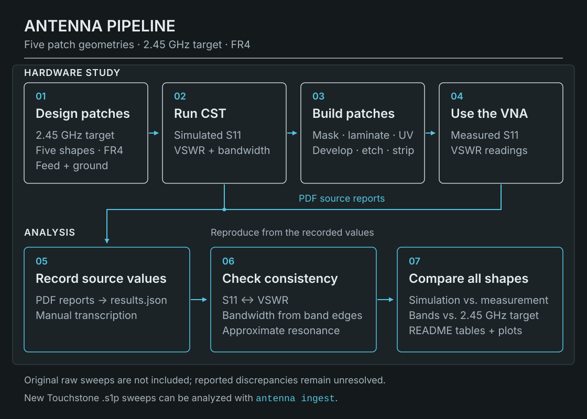</a>
  <br><sub><a href="https://www.figma.com/design/NjLkmRozV5EbUtvv6ulIFG?node-id=2-2">Figma source</a> · <a href="images/pipeline.svg">SVG</a></sub>
</p>

**2.45 GHz target · FR4 substrate · CST + VNA**

[Results](#results) · [Design](#design) · [Gallery](#gallery) · [Reproduce](#reproduce) · [References](#references)

<p align="center">
  <a href="images/antennas/all-five-geometries.jpg">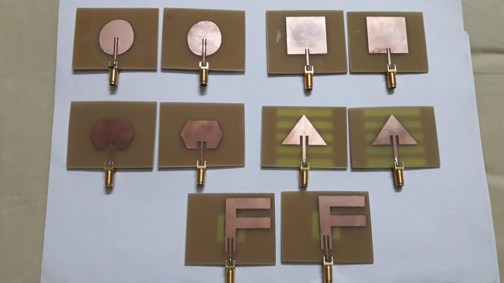</a>
  <br><sub>Circular, F-shaped, triangular, square and hexagonal patch antennas.</sub>
</p>

## Results

S11 minima occur at each shape’s resonance. **Circular has the deepest reported minimum; only its reported band includes 2.45 GHz.**

### S11 and VSWR

<!-- BEGIN:results-table -->
| Shape | Simulated S11 (dB) | Measured S11 (dB) | Reported VSWR | VSWR from measured S11 |
|---|---|---|---|---|
| **Circular** | **−53.08** | **−31.99** | **1.125** | **1.052** |
| F-shaped | −30.02 | −16.98 | 1.167 | 1.330 |
| Triangular | −18.86 | −15.37 | 1.368 | 1.411 |
| Square | −16.38 | −14.46 | 1.536 | 1.467 |
| Hexagonal | −14.78 | −13.93 | 1.694 | 1.504 |
<!-- END:results-table -->

The **5/5** reported S11/VSWR pairs disagree under a shared frequency and port reference. The reports do not establish those shared conditions. Calculated VSWR is a derived check, not a measurement.

<p align="center">
  <a href="outputs/s11_sim_vs_meas.png">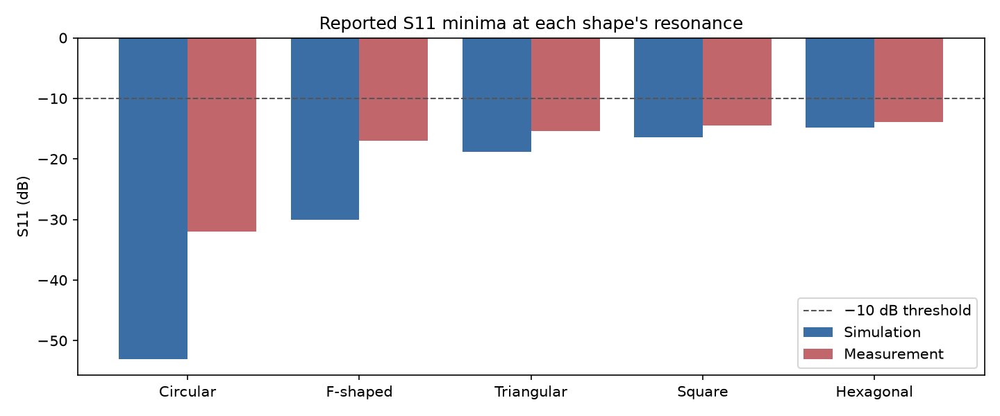</a>
</p>

### Reported simulation bands

<!-- BEGIN:bandwidth-table -->
| Shape | Reported band (GHz) | Reported BW (%) | BW from edges (%) |
|---|---|---|---|
| **Circular** | **2.3990 to 2.4735** | **3.12** | **3.06** |
| F-shaped | 2.2994 to 2.3735 | 2.98 | 3.17 |
| Triangular | 2.1380 to 2.2830 | 2.45 | 6.56 |
| Square | 2.0930 to 2.1732 | 2.41 | 3.76 |
| Hexagonal | 2.0945 to 2.2455 | 2.12 | 6.96 |
<!-- END:bandwidth-table -->

BW from edges uses `100 × (upper − lower) / midpoint`. The report does not establish the edge threshold or numeric normalization frequency. Circular is **3.62%** on p. 6 and **3.12%** on p. 20. Original CST sweeps are unavailable; all listed bands remain unverified.

<p align="center">
  <a href="outputs/reported_bands.png">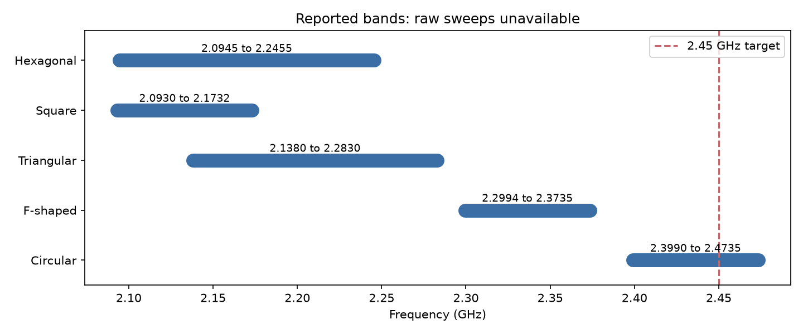</a>
</p>

<details>
<summary><strong>Supporting figures</strong> · 2 plots</summary>

#### Circular patch CST S11

<p align="center">
  <a href="outputs/s11_circular_cst.png">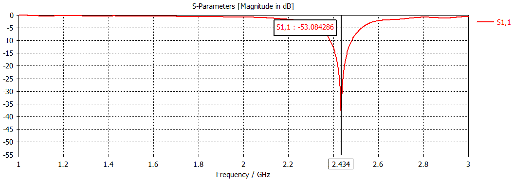</a>
</p>

#### Approximate resonance

<p align="center">
  <a href="outputs/resonance_vs_target.png">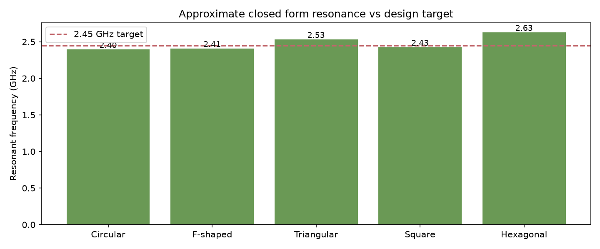</a>
</p>

</details>

## Design

Reconstruction parameters; see the [source audit](docs/source-audit.md) for reported dimensions and assumptions.

### Common parameters

| Parameter | Value |
|---|---|
| Substrate | FR4; εr 4.4; loss tangent 0.02 |
| Substrate thickness | 1.4 mm |
| Copper thickness | 0.036 mm |
| Ground plane | 75.20 × 58.76 mm |
| Feed width / gap | 2.7 / 1 mm |

### Patch dimensions

| Shape | Dimensions (mm) |
|---|---|
| Circular | Radius 17 |
| F-shaped | 37.60 × 29.38; vertical 10; bars 8; gap 3; middle 25 |
| Triangular | Base 37.60; height 29.38 |
| Square | Side 29.38 |
| Hexagonal | Side 17 |

## Gallery

<details>
<summary><strong>Antennas</strong> · 5 photos</summary>

<table>
  <tr>
    <td align="center" width="50%">
      <a href="images/antennas/circular-patch.jpg">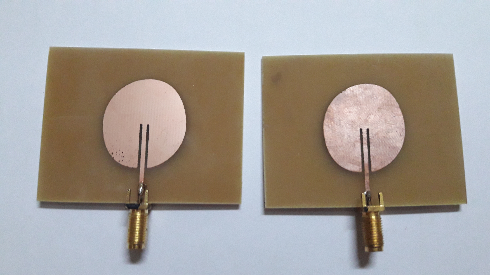</a>
      <br><sub>Circular</sub>
    </td>
    <td align="center" width="50%">
      <a href="images/antennas/f-shaped-patch.jpg">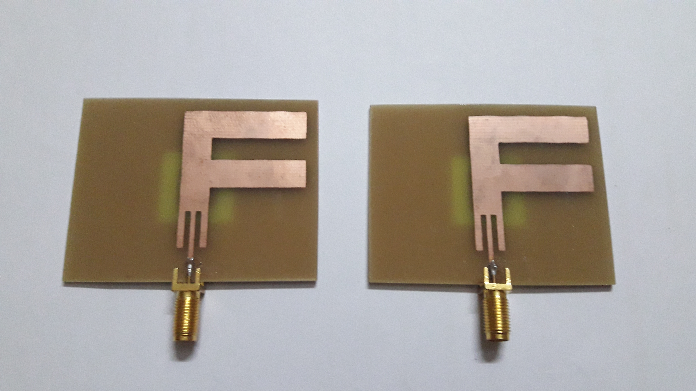</a>
      <br><sub>F-shaped</sub>
    </td>
  </tr>
  <tr>
    <td align="center" width="50%">
      <a href="images/antennas/triangular-patch.jpg">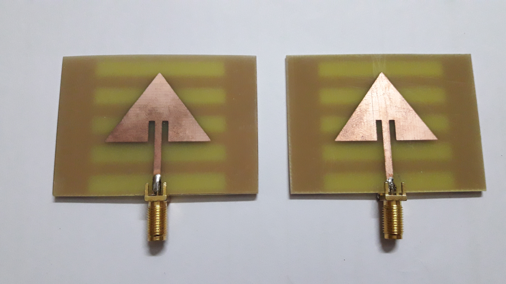</a>
      <br><sub>Triangular</sub>
    </td>
    <td align="center" width="50%">
      <a href="images/antennas/square-patch.jpg">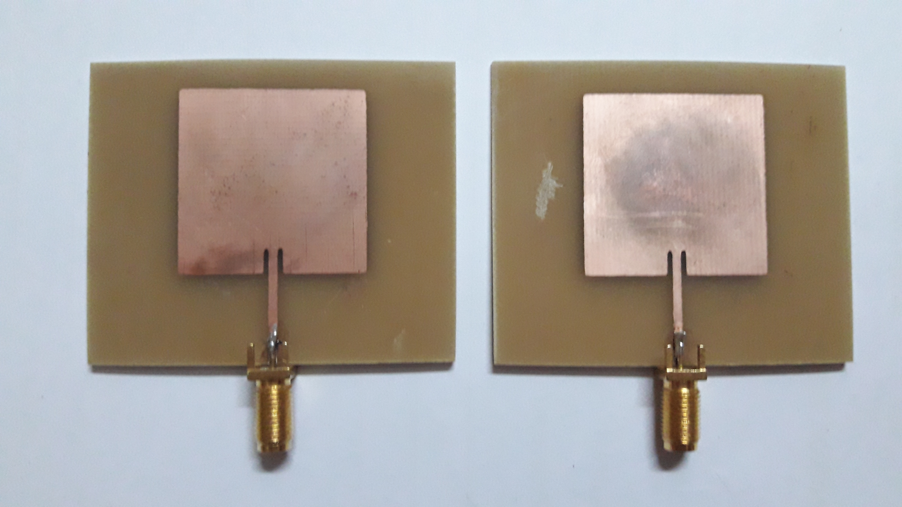</a>
      <br><sub>Square</sub>
    </td>
  </tr>
  <tr>
    <td colspan="2" align="center">
      <a href="images/antennas/hexagonal-patch.jpg">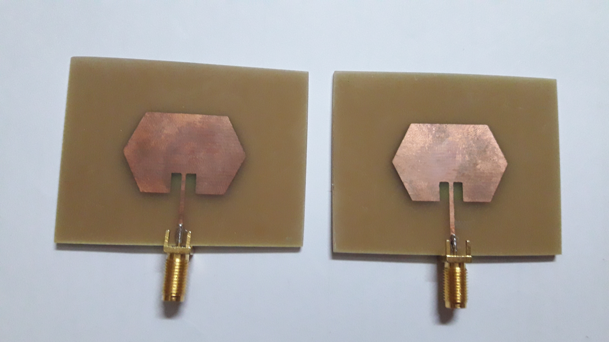</a>
      <br><sub>Hexagonal</sub>
    </td>
  </tr>
</table>

</details>

<details>
<summary><strong>Fabrication</strong> · 6 photos</summary>

<table>
  <tr>
    <td align="center" width="50%">
      <a href="images/fabrication/fr4-substrate-blank.jpg">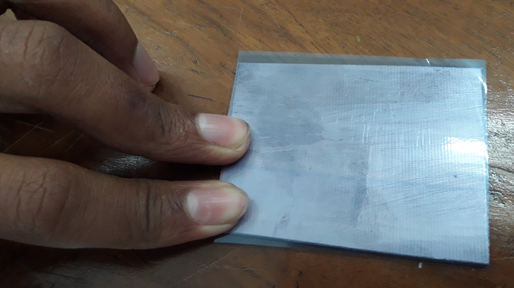</a>
      <br><sub>Blank FR4 substrate</sub>
    </td>
    <td align="center" width="50%">
      <a href="images/equipment/laminator.jpg">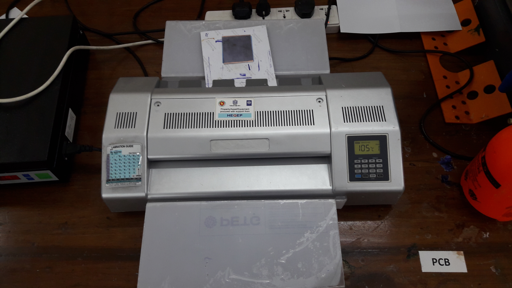</a>
      <br><sub>Laminator</sub>
    </td>
  </tr>
  <tr>
    <td align="center" width="50%">
      <a href="images/equipment/uv-exposure-open.jpg">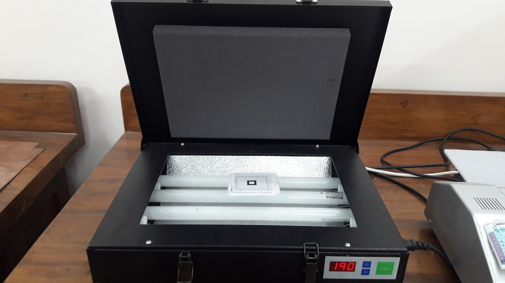</a>
      <br><sub>UV exposure unit · open</sub>
    </td>
    <td align="center" width="50%">
      <a href="images/equipment/uv-exposure-closed.jpg">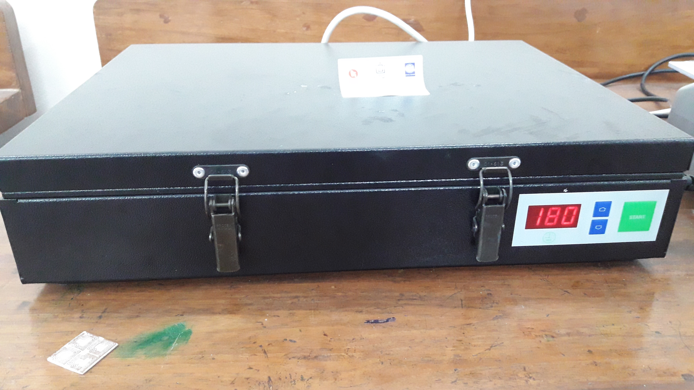</a>
      <br><sub>UV exposure unit · closed</sub>
    </td>
  </tr>
  <tr>
    <td align="center" width="50%">
      <a href="images/fabrication/circular-patch-naoh-bath.jpg">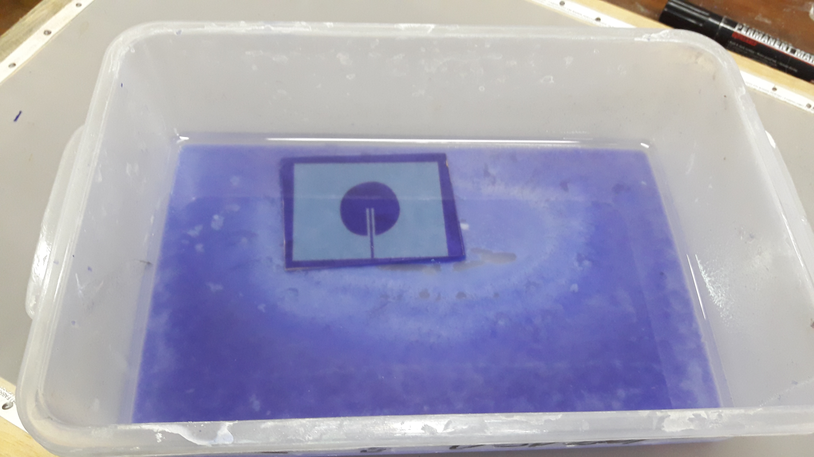</a>
      <br><sub>Circular patch in the NaOH bath</sub>
    </td>
    <td align="center" width="50%">
      <a href="images/equipment/etching-machine.jpg">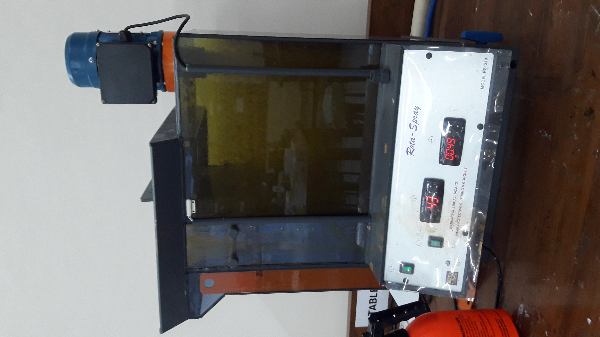</a>
      <br><sub>Etching machine</sub>
    </td>
  </tr>
</table>

</details>

<details>
<summary><strong>Measurement</strong> · 1 photo</summary>

<p align="center">
  <a href="images/equipment/vna-smith-chart.jpg">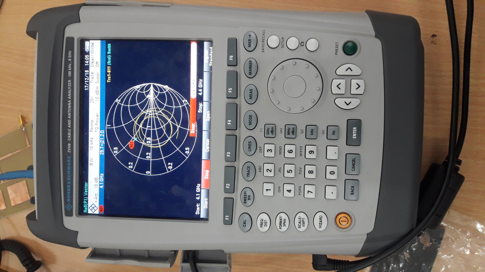</a>
  <br><sub>VNA Smith chart</sub>
</p>

</details>

## Reproduce

Requires Python 3.9+. Run from the repository root:

```sh
python -m pip install -e ".[plots,dev]"
antenna check
antenna tables --check --readme README.md
python -m pytest
```

Source: [`src/antenna/`](src/antenna/) · Tests: [`tests/`](tests/).

<details>
<summary><strong>Additional commands</strong></summary>

| Task | Command |
|---|---|
| Generate comparison plots | `antenna plot --out outputs` |
| Analyze a supplied Touchstone sweep | `antenna ingest path/to/trace.s1p` |
| Refresh generated README tables | `antenna tables --write --readme README.md` |
| Estimate resonance / primary dimension | `antenna design` / `antenna synth` |

Replace `path/to/trace.s1p` with your sweep file.

</details>

### CST model

Open [`cst/patch-antenna.bas`](cst/patch-antenna.bas) in CST Studio Suite’s VBA editor; select `PatchShape` and run in a fresh project. Its simplified gap-coupled feed differs from the report’s inset feeds and requires CST validation.

## References

Source reports: [Simulation and results](docs/simulation-and-results.pdf) · [Fabrication and measurement](docs/fabrication-and-measurement.pdf) · [Methodology](docs/methodology.pdf)

### Evidence limits

1. No original CAD/CST files, raw sweeps, reading/calibration records or repeat measurements are available; report conflicts remain unresolved.
2. Closed form models approximate the triangle, hexagon and F shape. Radiation figures mix simulated directivity and gain; mixed-quantity proxies are suppressed.
3. Hardware performance and 2.45 GHz suitability require new measurements, recorded separately from these historical values.

`antenna check`: 0 errors, 8 unresolved warnings and 3 informational estimates. A successful exit does not verify measurements.

<details>
<summary><strong>Background references</strong></summary>

| Reference | Use |
|---|---|
| [Balanis, *Antenna Theory*, 4th ed., 2016](https://www.wiley.com/en-us/Antenna+Theory%3A+Analysis+and+Design%2C+4th+Edition-p-9781118642061) | Patch equations |
| [Garg et al., *Microstrip Antenna Design Handbook*, 2001](https://us.artechhouse.com/Microstrip-Antenna-Design-Handbook-P619.aspx) | Patch geometries |
| [Pozar, *Microstrip Antennas*, 1992](https://doi.org/10.1109/5.119568) | Radiation and design limits |
| [IBIS, Touchstone specification](https://www.ibis.org/touchstone_ver2.1/touchstone_ver2_1.pdf) | Sweep format |

</details>

[MIT License](LICENSE)
